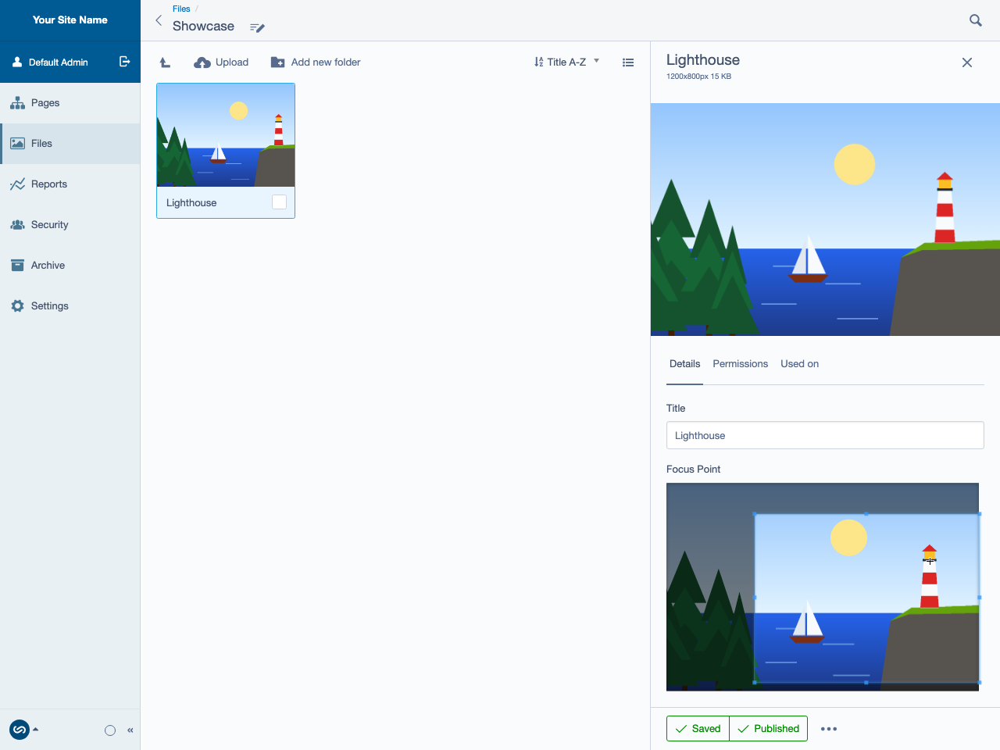
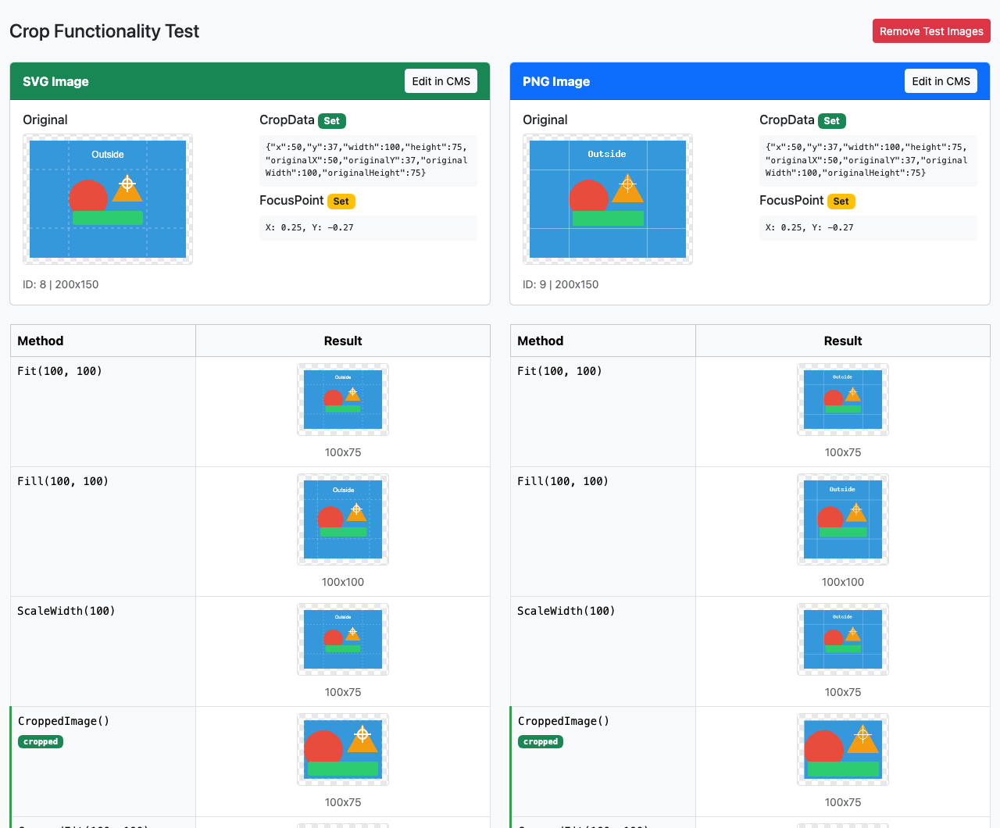

# FocusPointCropper: editor-chosen image crops for Silverstripe

Let editors decide how an image is cut. In the Files section of the CMS they drag a crop box over
the image to keep the part that matters, and click its subject to set the focus point. In
templates, the `Cropped*` image methods (`$Image.CroppedFocusFill(400, 300)` and friends) start
from that region and keep the focus point in view, at every size you ask for. Builds on
[jonom/focuspoint](https://github.com/jonom/silverstripe-focuspoint), for Silverstripe 5 and 6.



*Maintained by [Restruct](https://github.com/restruct). If this module saves you time, you can
[support ongoing maintenance](https://github.com/sponsors/restruct).*

## A focus point alone cannot leave anything out

Core's `Fill()` crops around the centre of the image. jonom/focuspoint improves on that: an editor
clicks the subject, and `FocusFill()` crops around that point instead. But every crop still starts
from the whole upload, so whatever the photographer caught at the edge (a lamp post, a stranger, a
watermark) comes back whenever the requested shape has room for it, and the editor has no way to
say "never show this part".

This module adds that missing step. The editor marks the region to keep, once, in the CMS; every
`Cropped*` variant in the templates is cut from that region, and the focus-aware ones also move the
focus point into the cropped frame, so it keeps pointing at the same subject.


## Crop and focus in the CMS, crop-aware variants in templates

### Setting the crop region and focus point

Open an image in Files (the asset admin). The module puts a crop box on the image preview of the
Focus Point field that jonom/focuspoint adds to the edit form:

1. **Drag the corners or edges** of the crop box to set the region to keep. With the default
   configuration the box covers the whole image when there is no crop yet, and the image itself
   does not move or zoom.
2. **Click** the subject of the image, inside the crop box, to set the focus point.
3. **Save**, and **publish** the image to use the crop on the live site: the crop is stored on the
   image record (`CropData`), which is versioned like the rest of it.

An image with a stored crop opens with the crop box on that region.

### Using the crop in templates

The module adds `Cropped*` methods to `Image`. Each one first cuts the stored crop region out of the
original, then does the manipulation it is named after. Without CropData (or with CropData covering
the whole image) they behave exactly like the plain method, so they are safe to use on every image.
The plain methods (`Fill()`, `FocusFill()` and so on) are not changed: they keep using the whole
image. The result is a normal image variant, generated once and cached.

```ss
<%-- The crop region, filled to 400 x 300 around the focus point --%>


<%-- The crop region, filled to 400 x 300 from its centre --%>


<%-- Plain core method: ignores the crop region --%>

```

**Cropped methods**, the crop region then the core manipulation:

- `CroppedImage()`: just the crop region, at its original resolution
- `CroppedFill($width, $height)`, `CroppedFillMax($width, $height)`
- `CroppedFit($width, $height)`, `CroppedFitMax($width, $height)`
- `CroppedScaleWidth($width)`, `CroppedScaleMaxWidth($width)`, `CroppedScaleHeight($height)`, `CroppedScaleMaxHeight($height)`
- `CroppedResizedImage($width, $height)`
- `CroppedCropWidth($width)`, `CroppedCropHeight($height)`
- `CroppedPad($width, $height, $backgroundColor = 'FFFFFF', $transparencyPercent = 0)`

**Focus-aware cropped methods**, the crop region then jonom/focuspoint's manipulation. The focus
point is moved into the cropped frame first (clamped to the frame's edge when it lies outside the crop region), so it keeps pointing at the same subject:

- `CroppedFocusFill($width, $height)`: fill around both the crop region and the focus point
- `CroppedFocusFillMax($width, $height)`: the same, without upscaling
- `CroppedFocusCropWidth($width)`: crop to a width, respecting both the crop region and the focus point
- `CroppedFocusCropHeight($height)`: crop to a height, respecting both the crop region and the focus point

**Aliases** kept from 1.x: `CroppedFocusedImage($width, $height)` (= `CroppedFocusFill`) and
`CroppedImageOnly($width, $height)` (= `CroppedFill`).

`CroppedOffsetFocusFill($width, $height, $offsetHorizontal = 0, $offsetVertical = 0)` is work in
progress: horizontal offset only (a vertical offset raises an error).

### SVG images

Together with [restruct/silverstripe-svg-images](https://github.com/restruct/silverstripe-svg-images),
the crop region also applies to SVG files: svg-images detects this module and crops the SVG's
viewBox, so the result is still a vector. Known limitation: on an SVG the focus-aware methods do
not use the focus point yet (`CroppedFocusFill()` fills from the centre of the crop region,
`CroppedFocusCropWidth()`/`CroppedFocusCropHeight()` return the region uncropped), see
[#11](https://github.com/restruct/silverstripe-focuspointcropper/issues/11).

## Requirements and compatibility

| Branch | Module Version | Silverstripe | FocusPoint | PHP |
|--------|----------------|--------------|------------|-----|
| `main` | `3.x` | `^5 \|\| ^6` | `^5 \|\| ^6` | `^8.1` (SS5) / `^8.3` (SS6) |
| (tags only) | `2.0.x` | `^4 \|\| ^5` | `^3`, later `^4 \|\| ^5` | `^7.4 \|\| ^8.0` |
| (tags only) | `1.x` | `^3` | `~2.1` | |

`composer.json` is the source of truth for exact version constraints. This module replaces the
older `micschk/silverstripe-focuspointcropper` package.

- Silverstripe 5 (PHP 8.1+) or 6 (PHP 8.3+, which Silverstripe 6 itself requires)
- [jonom/focuspoint](https://github.com/jonom/silverstripe-focuspoint) `^5` (Silverstripe 5) or `^6` (Silverstripe 6)
- [restruct/silverstripe-simpler](https://github.com/restruct/silverstripe-simpler) `~0.2` (Silverstripe 5) or `^1` (Silverstripe 6)
- `ext-gd` (or Imagick) for the raster crop, as for any Silverstripe image manipulation

Silverstripe 4 reached end of life in April 2025 and is no longer supported or tested here. Projects
still on it should stay on the `2.0.x` tags, which remain available. Upgrading from 2.x? See
[UPGRADING.md](UPGRADING.md) and [CHANGELOG.md](CHANGELOG.md).

## Installation

```bash
composer require restruct/silverstripe-focuspointcropper
```

Then flush and build the database (`sake dev/build flush=1` on Silverstripe 5,
`sake db:build --flush` on 6): the module adds a `CropData` column to `Image`.

## Configuration

`cropconfig` is passed to the [Cropper.js](https://github.com/fengyuanchen/cropperjs) crop box
as-is. It is configured on `Image` (the extension's config is merged into the class it is applied
to):

```yaml
SilverStripe\Assets\Image:
  cropconfig:
    aspectRatio: 1.777  # 16:9 ratio
    autoCropArea: 0.8   # Initial crop covers 80% of image
```

Defaults: `autoCropArea: 1`, `movable: false`, `rotatable: false`, `scalable: false`,
`zoomable: false`. For all available cropper options, see the
[Cropper.js 1.5 documentation](https://github.com/fengyuanchen/cropperjs/blob/v1.5.11/README.md#options) (the bundled version).
The module's tests cover the defaults; options that move or zoom the image are passed through, but
are not tested together with the focus point picker that shares the preview.

The CMS preview the cropper works on is FocusPointField's, which this module sets to at most
400x300:

```yaml
JonoM\FocusPoint\Forms\FocusPointField:
  max_width: 400
  max_height: 300
```

## How the crop is stored

`CropData` is a JSON string on the `Image` record, as Cropper.js reports the crop box: `x`, `y`,
`width` and `height` in pixels of the CMS preview, `originalX`, `originalY`, `originalWidth` and
`originalHeight` in pixels of the original image, plus Cropper.js's `rotate`, `scaleX` and `scaleY`.
The `Cropped*` methods use the `original*` values only, so a crop stays valid when the preview size
changes.

### Republishing crop data: `PublishCropDataTask`

Crop data is saved on the draft image. For published images whose live version has no CropData
while the draft does, this task republishes them, 100 per run (run it again for the next batch):

```bash
vendor/bin/sake dev/tasks/PublishCropDataTask   # Silverstripe 5
vendor/bin/sake tasks:PublishCropDataTask       # Silverstripe 6
```

Images whose live version already has (other) CropData are left alone.

## Development tool: `/dev/crop-compare`

A visual comparison page at `/dev/crop-compare` renders every `Cropped*` method next to the plain
one, for an SVG and a PNG side by side. It is open to anyone in dev mode; otherwise only to
administrators (`ADMIN` or `ALL_DEV_ADMIN`). The SVG sample needs
[restruct/silverstripe-svg-images](https://github.com/restruct/silverstripe-svg-images); without it,
installing the test images installs the PNG only and the page shows the PNG column alone.



The tool:

- Tests all Cropped* methods (CroppedImage, CroppedFill, CroppedFocusFill, etc.)
- Compares regular manipulations with Cropped* versions
- Shows badges indicating which methods use CropData and/or FocusPoint
- Includes bundled test images with pre-configured CropData and FocusPoint
- Works with custom image IDs for testing your own images (one SVG and one PNG ID)

**Test image features:**

- **Lines** mark the crop boundaries (dashed on the SVG)
- **"Outside"** is printed above the crop region, so it must be gone from every cropped result
- **White crosshair** marks the FocusPoint location
- **Orange triangle** is near the FocusPoint - should stay visible in FocusFill crops
- **Red circle** is left of center - may be cropped in narrow FocusFill

## Related modules

- [jonom/focuspoint](https://github.com/jonom/silverstripe-focuspoint) - Required. Provides the FocusPoint field and basic focus-aware cropping
- [restruct/silverstripe-svg-images](https://github.com/restruct/silverstripe-svg-images) - Optional. Enables SVG support, including the crop region on SVGs
- [restruct/silverstripe-simpler](https://github.com/restruct/silverstripe-simpler) - Required. Provides the `DOMNodesInserted` event the cropper script initialises on

## Running the tests

The suite needs a booted Silverstripe project. Install the module into one through a path
repository with `"symlink": true` (the `tests/` folder is excluded from dist installs), map
`Restruct\ImageCropper\Tests\` to `vendor/restruct/silverstripe-focuspointcropper/tests/` in its
`autoload-dev`, then:

```bash
# Silverstripe 5 (PHPUnit 9): the path must come first for flush=1 to work
vendor/bin/phpunit vendor/restruct/silverstripe-focuspointcropper/tests flush=1
# Silverstripe 6 (PHPUnit 11): flush through the environment instead
SS_PHPUNIT_FLUSH=1 vendor/bin/phpunit vendor/restruct/silverstripe-focuspointcropper/tests
```

`.github/workflows/ci.yml` builds such a project per Silverstripe major. Browser tests (Playwright)
for the crop field and `/dev/crop-compare` live in `tests/browser/`; the README screenshots are
generated from there too, see [tests/browser/screenshots/README.md](tests/browser/screenshots/README.md).

## License

BSD-3-Clause, see [LICENSE](LICENSE), as every earlier release declared.
